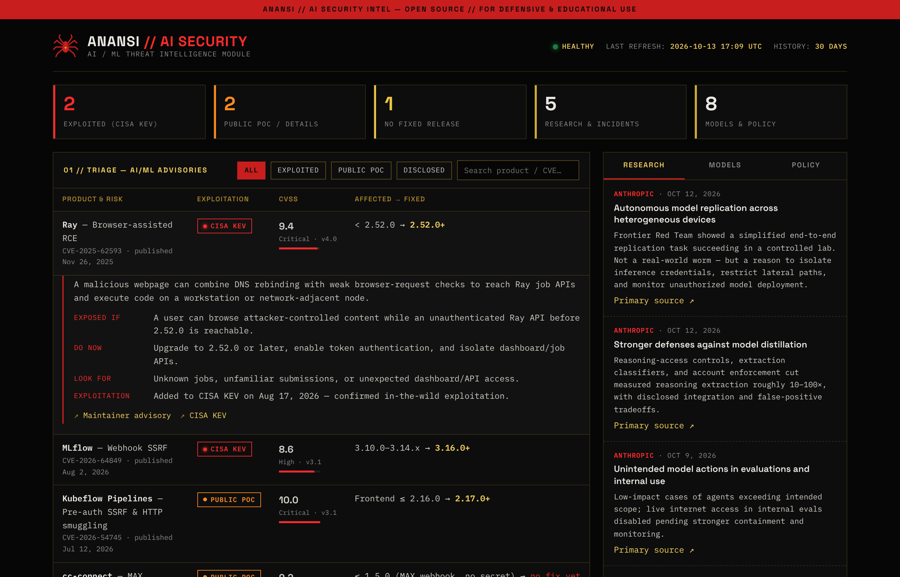

# Ananasi-intel

**Anansi** is a self-hosted intelligence project with two modules:

1. **Operation 757 — Regional Intelligence Dashboard.** A real-time CesiumJS 3D globe for the Hampton Roads / Historic Triangle region of Virginia. Self-hosted n8n workflows pull live traffic (TomTom), weather alerts (NOAA/NWS), and local news (Google News RSS) into one operational picture, now with live **ship tracking** (AIS) for the port and naval base.
2. **AI Security Intelligence Dashboard** *(new)*. Tracks the AI/ML attack surface: actively exploited vulnerabilities in AI infrastructure, AI security research and incidents, frontier-model releases, and AI-related executive orders.

🔗 **Live site:** https://tvw-80.github.io/Ananasi-intel/
📄 **Operation debrief:** [`anansi/`](https://tvw-80.github.io/Ananasi-intel/anansi/)
🛡️ **AI Security dashboard:** [`ai-security/`](https://tvw-80.github.io/Ananasi-intel/ai-security/)

---

## AI Security Intelligence Dashboard

A source-linked view of what defenders need to act on across the AI ecosystem.

- **Triage board.** Advisories are ranked by exploitation evidence first (CISA KEV → public PoC → vendor-disclosed), then EPSS, then CVSS, so an exploited issue outranks a higher-scored one nobody is exploiting.
- **Every advisory includes** affected versions, the fixed release, exploitation status, CVSS severity, what to look for, recommended actions, and links to primary sources (maintainers, CISA, the CVE Program).
- **Filters and search** by exploitation status, product, or CVE.
- **Summary counts** for exploited issues, public PoCs, and advisories with no fixed release.
- **EPSS scores** (FIRST.org) on every advisory: the estimated chance of exploitation activity in the next 30 days.
- **Right-rail intel feed** with tabs for AI security research, frontier-model releases, AI-related executive orders, and a 30-day **change history**.

### Daily automation

A [GitHub Action](.github/workflows/update-ai-security.yml) runs every morning (11:17 UTC) and on demand from the Actions tab. It runs [`scripts/update_intel.py`](ai-security/scripts/update_intel.py), which:

1. Pulls the **CISA Known Exploited Vulnerabilities** catalog and keeps AI/ML products (MLflow, Ray, Langflow, LiteLLM, Kubeflow, Jupyter, Ollama, vLLM, …).
2. Adds new matches as advisories, filling in CVSS, affected versions, and fix versions from the official **CVE record**. These entries are flagged **AUTO** until reviewed.
3. Upgrades existing advisories to "exploited" when CISA confirms exploitation, without overwriting hand-written text.
4. Adds **EPSS** scores to every advisory and records changes in a rolling 30-day history.
5. Rebuilds `index.html` and commits only if something changed.

If the CISA feed is down it falls back to CISA's GitHub mirror. If EPSS is unreachable it keeps the previous scores and shows the dashboard as **Degraded**.

### How it works

| File | Purpose |
| --- | --- |
| `ai-security/data/ai-security.json` | All intel in one normalized schema (single source of truth) |
| `ai-security/src/dashboard.html` | Dashboard template |
| `ai-security/build.py` | Embeds the JSON as seed data into `ai-security/index.html` |
| `ai-security/index.html` | Built dashboard, served by GitHub Pages |
| `ai-security/scripts/update_intel.py` | Daily KEV + CVE record + EPSS updater (standard library only) |

To add curated content by hand: edit `data/ai-security.json`, then run `python3 build.py` from the `ai-security/` folder. To run the updater yourself: `python3 scripts/update_intel.py` (add `--dry-run` to preview). The page loads the JSON when served and falls back to the embedded copy when opened from disk.

### Credit

The AI Security module is a remake of the **AI Security Intelligence Dashboard** by [CYBERMED1C](https://github.com/CYBERMED1C/AI-Tracker). The concept, advisory format, and curated intelligence are theirs; Anansi rebuilds the presentation as a structured, interactive dashboard.

> This is an intelligence and educational resource, not a substitute for vendor advisories or your own asset inventory. Verify affected versions and mitigations against each primary source.

---

## Hampton Roads Maritime (AIS)

Live ship tracking for the Port of Virginia, Naval Station Norfolk, and the bridge-tunnels, built on the base platform's AISStream vessel layer. It sets up a Hampton Roads-only AIS subscription and adds a 757-panel feed that places each vessel in a port zone and ranks what matters: responders first, then tankers and cargo ships moving through the HRBT, CBBT, and Thimble Shoal Channel.

Setup, `.env` settings, and wiring instructions are in [`integrations/hampton-roads-maritime/`](integrations/hampton-roads-maritime/). Vessel data comes from [AISStream.io](https://aisstream.io).

---

## Credits

Operation 757 is built on top of **God's Eye View** by [Bilawal Sidhu](https://github.com/bilawalsidhu/gods-eye-view), an open-source CesiumJS geospatial visualization platform. Full credit for the foundation that project builds on.
