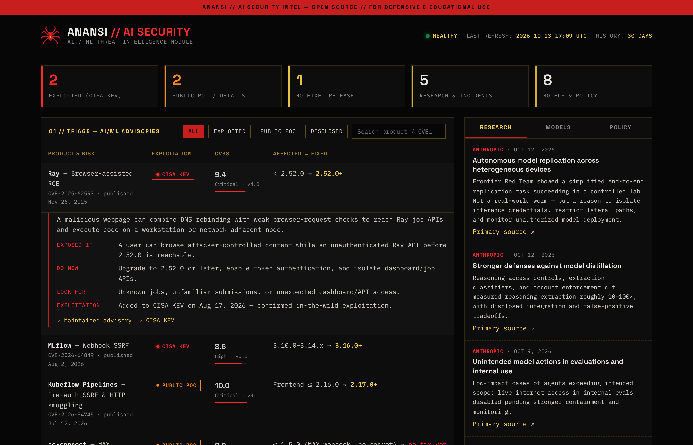

# Ananasi-intel

**Anansi** is a self-hosted intelligence project with two modules:

1. **Operation 757 — Regional Intelligence Dashboard.** A real-time CesiumJS 3D globe for the Hampton Roads / Historic Triangle region of Virginia. Self-hosted n8n workflows pull live traffic (TomTom), weather alerts (NOAA/NWS), and local news (Google News RSS) into one operational picture.
2. **AI Security Intelligence Dashboard** *(new)*. Tracks the AI/ML attack surface: actively exploited vulnerabilities in AI infrastructure, AI security research and incidents, frontier-model releases, and AI-related executive orders.

🔗 **Live site:** https://tvw-80.github.io/Ananasi-intel/
📄 **Operation debrief:** [`anansi/`](https://tvw-80.github.io/Ananasi-intel/anansi/)
🛡️ **AI Security dashboard:** [`ai-security/`](https://tvw-80.github.io/Ananasi-intel/ai-security/)

---

## AI Security Intelligence Dashboard

A source-linked view of what defenders need to act on across the AI ecosystem.

- **Triage board.** Advisories are ranked by exploitation evidence first (CISA KEV → public PoC → vendor-disclosed) and CVSS second, so an exploited issue outranks a higher-scored one nobody is exploiting.
- **Every advisory includes** affected versions, the fixed release, exploitation status, CVSS severity, what to look for, recommended actions, and links to primary sources (maintainers, CISA, the CVE Program).
- **Filters and search** by exploitation status, product, or CVE.
- **Summary counts** for exploited issues, public PoCs, and advisories with no fixed release.
- **Right-rail intel feed** with tabs for AI security research, frontier-model releases, and AI-related executive orders.

### How it works

| File | Purpose |
| --- | --- |
| `ai-security/data/ai-security.json` | All intel in one normalized schema (single source of truth) |
| `ai-security/src/dashboard.html` | Dashboard template |
| `ai-security/build.py` | Embeds the JSON as seed data into `ai-security/index.html` |
| `ai-security/index.html` | Built dashboard, served by GitHub Pages |

To update: edit `data/ai-security.json`, then run `python3 build.py` from the `ai-security/` folder. The page loads the JSON when served and falls back to the embedded copy when opened from disk.

### Credit

The AI Security module is a remake of the **AI Security Intelligence Dashboard** by [CYBERMED1C](https://github.com/CYBERMED1C/AI-Tracker). The concept, advisory format, and curated intelligence are theirs; Anansi rebuilds the presentation as a structured, interactive dashboard.

> This is an intelligence and educational resource, not a substitute for vendor advisories or your own asset inventory. Verify affected versions and mitigations against each primary source.

---

## Credits

Operation 757 is built on top of **God's Eye View** by [Bilawal Sidhu](https://github.com/bilawalsidhu/gods-eye-view), an open-source CesiumJS geospatial visualization platform. Full credit for the foundation that project builds on.
